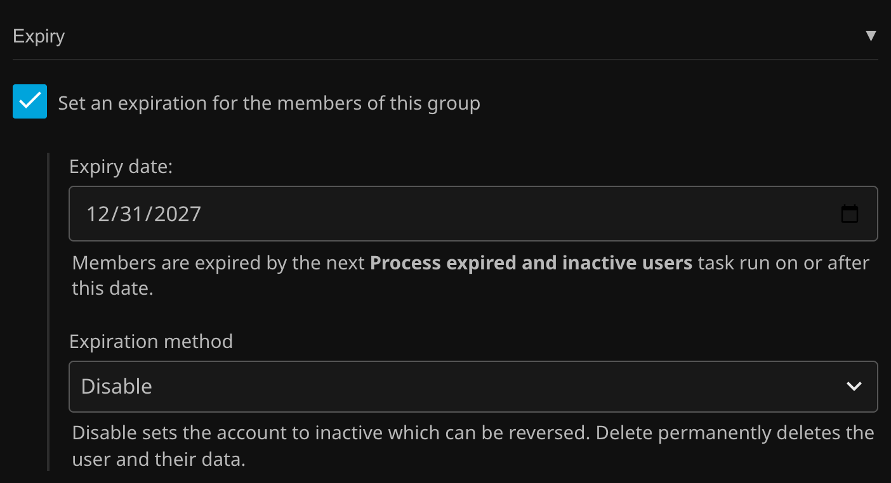

# Expiration

Give a group an expiration date and its members are disabled once that date passes. This is checked by the `Process expired and inactive users` **Scheduled Task**, so you determine what time of day these expirations occur.

Turn on expiration and pick a date under **Expiry** in the group's **Other** section.

There is an optional setting to change the disable action into a **deletion**.

!!! danger
    Deletion is irreversible, so use it with care!
