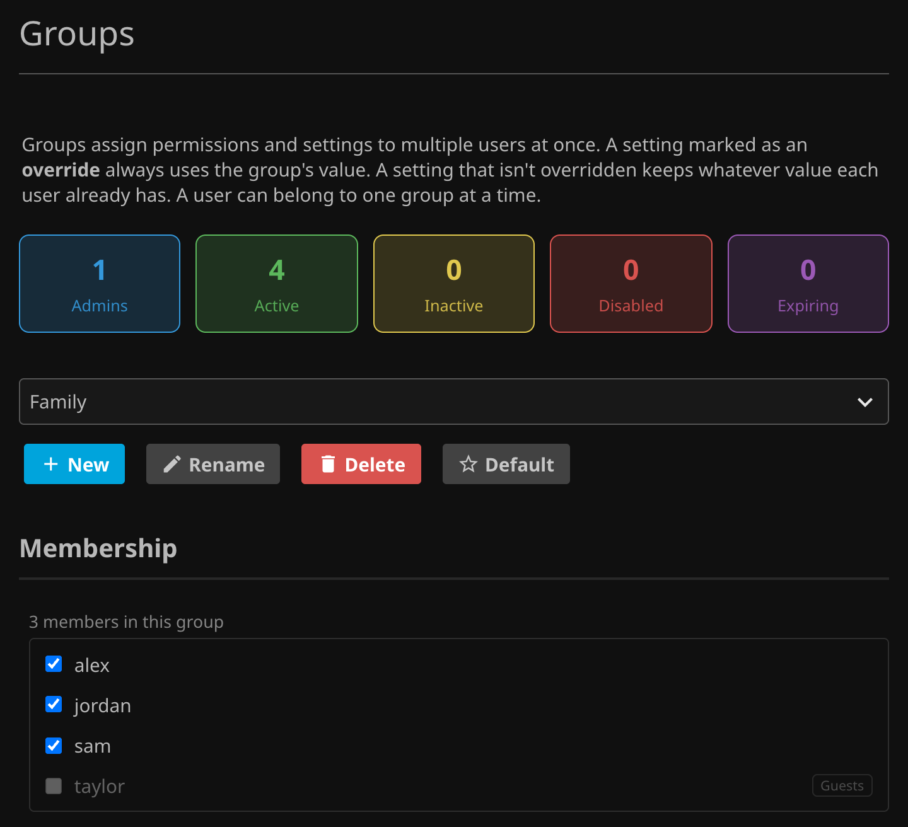

# Groups

A group is a set of permissions and settings applied to many users at once. Each setting is either an **override**, where it is forced onto every member, or left alone, so the member keeps whatever they already have. Members resync when you save and on a schedule, correcting any manual drift.

Pick a group from the dropdown and tick the users who belong to it under **Membership**.

This is performed by looping over all users assigned to a group and updating their `UserDto.Policy` to conform to your group settings. Any elements that are *not set* to override are retained from the original `UserDto.Policy` in the current user configuration.

Each setting has an **Override** checkbox. Only overridden settings are pushed to members.

