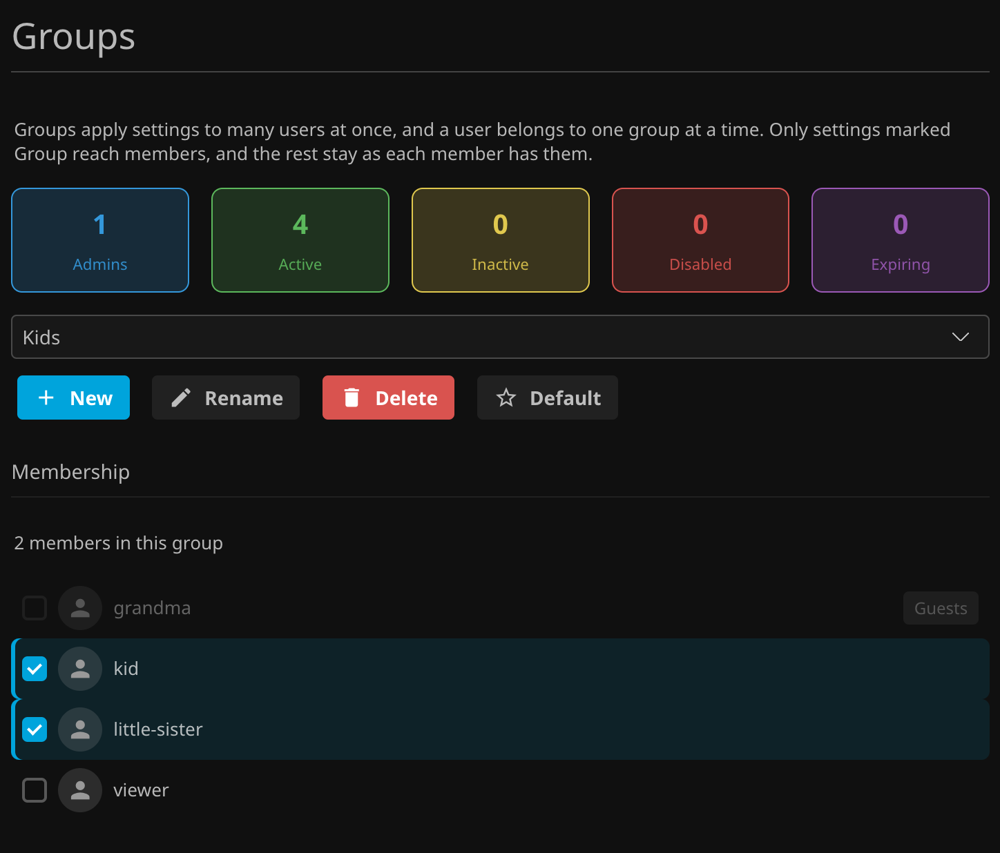

# Groups

A group is a set of permissions and settings applied to many users at once. Members resync when you save and on a schedule, correcting any manual drift.

Pick a group from the dropdown and tick the users who belong to it under **Membership**.

## Who Sets Each Setting

Every setting is a row with two pills beside its name.

* **Group sets this**: The group's value is written onto every member. The row shows the setting's controls.
* **Member's own**: The group leaves the setting alone, so each member keeps what they already have. The row dims its name and hides its controls.

A collapsible section counts its rows on **Group sets this** in its header, such as **2 Set by Group**.

This is performed by looping over all users assigned to a group and updating their `UserDto.Policy` and `UserDto.Configuration` to match the rows on **Group sets this**. Every other value is kept from the user's current policy and configuration.

## Sections

| Section | What it holds |
| :--- | :--- |
| **Access and Features** | Library Access, Device Access, Media Deletion, Media Playback, Live TV, Remote Control, Parental Control, and Profile, as on Jellyfin's user pages |
| **Preferences** | Subtitles, Playback, Display, and Home, as on a user's own preference pages |
| **Account Rules** | Session Management, Password Requirements, Expiry, and Inactivity, each turned on by its first checkbox |

Library Access, Device Access, and Media Deletion each start with an "all" checkbox, as Jellyfin does. Turn it off to pick libraries, channels, or devices from a searchable list under it. The home screen library rows list only the libraries the group's Library Access lets members open.
