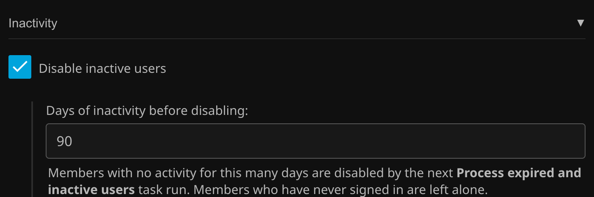

# Inactivity

Set an inactivity limit for users in a group. Users who have not been active within this window are disabled when checked by the `Process expired and inactive users` **Scheduled Task**. Accounts that have never signed in are ignored to prevent first time users from being disabled.

Turn it on and set the number of days under **Inactivity** in the group's **Other** section.

